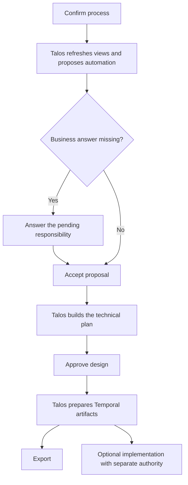

# One-App: guided translation after process confirmation

The user confirms business meaning. Talos then prepares a read-only automation
proposal, refreshes the three representations, and displays the next useful step.
The user does not need Technical details to refresh the workspace or enter Temporal
coordinates to export a design.

## Responsibility

- Perception providers, including Gemini, continue to extract observable evidence.
- Talos normalizes and validates that evidence through the existing Canonical path.
- A versioned deterministic proposal projects execution directions from the exact
  confirmed process. It does not change Canonical semantics.
- The user answers unknown responsibilities, accepts an automation proposal, and
  approves the resulting design. Deployment and workflow start retain their
  existing separate authorization boundaries.

## Product flow



## Proposal rules and limits

Confirmed human, system and AI actors take priority. Unknown or mixed actors stay
unresolved. When an action has no actor, bounded English/Spanish label rules can
suggest request intake or notification work. Other activities ask who or what
performs them. Labels never establish a provider, a connection, a business rule,
or a person's responsibility.

For example, `Enviar solicitud` can suggest form/API intake; `Informar rechazo`
and `Notificar resultado` can suggest notifications. `Revisar solicitud` and
`Ejecutar atención` remain business questions unless the confirmed process
already establishes their execution nature. An unknown activity is never assigned
to a generic process operator by default.

Accepting a proposal uses the existing explicit design handoff and capability
selection path. Suggested automated work is recorded as a `TEST_ONLY` design
contract with a `proposal-contract:` reference. This is not a live connector.
Portable Temporal exports retain Activity adapter implementation requirements;
the UI distinguishes export readiness from execution readiness. Arbitrary
integration discovery or live connector implementation is outside this change.

## State, recovery and failure handling

- The confirmation event carries the complete confirmed response. Visual state
  no longer depends on a later fetch wrapper intercepting an earlier closure.
- `GET /api/product/automation-proposal` requires exact BPMN and Canonical revision
  IDs and a matching durable confirmation. It performs no semantic freeze,
  capability binding, automation approval, deployment or workflow start.
- Workspace snapshots can select an exact BPMN revision. Default recovery uses
  the newest BPMN draft, rather than falling back to an older confirmed process.
- Recovery of an existing process remains an explicit **Resume previous process**
  choice, visible in the main workspace. Read-only views and approved design
  exports can recover; deployment/start authority is never restored implicitly.
- New source/edit operations invalidate prior exports. Revision/operation checks
  discard stale proposal, mapping and export results.
- A preparation failure displays **Retry preparation** in the main Temporal view.
  Repeated design handoffs and identical capability selection requests reuse the
  existing in-memory result. Changed accepted selections are rejected.
- Plan-review events and durable snapshots update both history and stage status.
- A blocked plan names the exact connection or subprocess that needs a design
  answer. The main view offers business-language coordination choices and applies
  them through the existing execution-review API. Missing business meaning routes
  back to guided process review and requires confirmation of the corrected process.
- Accepted capability directions are locked after selection and recover with the
  pending plan after reload/restart. Recovery restores reviewed design facts only;
  it does not restore approval or runtime authority. Identical answer submissions
  reuse the response, and new answers append a parent-linked plan revision while
  reusing its immutable definition.
- Temporal export does not require a configured runtime target. Infrastructure
  configuration is deferred to optional implementation.

## Validation

Run the relevant regressions from `build/reference-vertical-slice`:

```bash
npm ci
npm run architecture:verify
node --experimental-strip-types --test tests/business-automation-proposal.test.ts tests/r1-13*.test.ts tests/image-i8-02d-r1-11d-business-first.test.ts
```

The new tests cover actorless intake/notification suggestions, unresolved work,
confirmed/mixed actor precedence, exact-revision rejection, read-only preparation,
new-source isolation, and proposal recovery after restart. Existing authority and
portability regressions continue to guard downstream execution boundaries.

Browser verification should import a process, confirm it without opening Technical
details, answer the pending business questions, accept the proposal, approve the
design, and download the Temporal package without a runtime target. Also verify
reload/resume, a transient proposal failure and a delayed response after new input.
These are internal implementation checks, not external field-trial certification.
